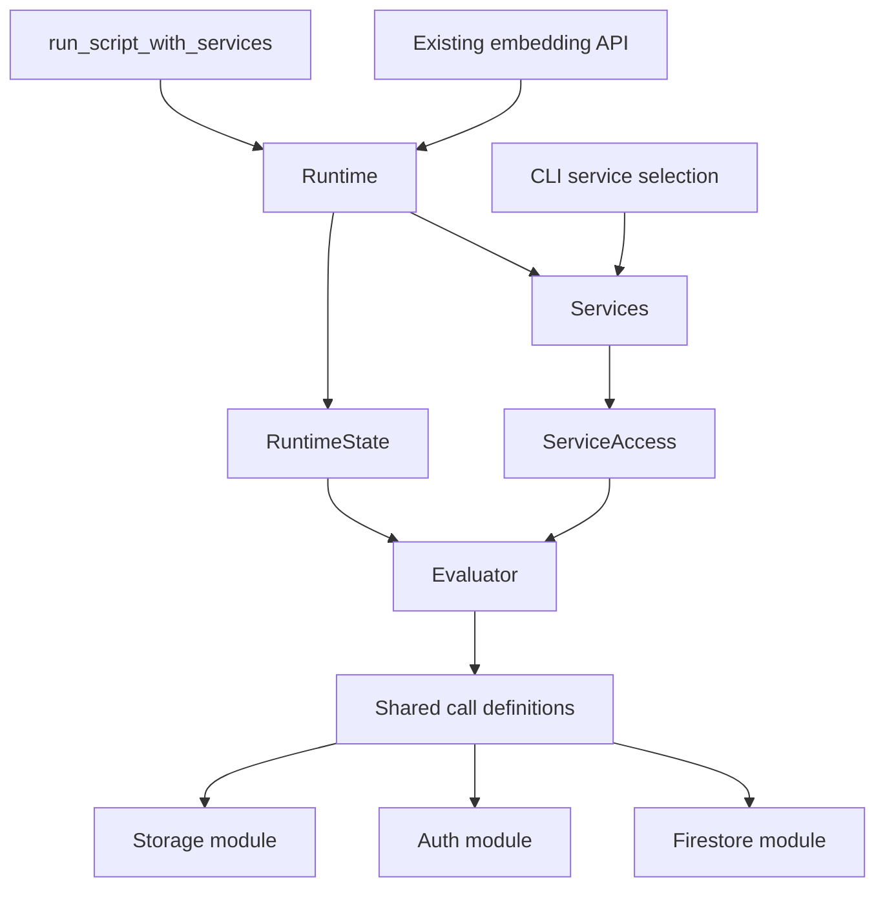

# Design Proposal: Firebase Services and Built-in Modules

Applies to [Issue #78](https://github.com/hirokazumiyaji/flare/issues/78).

This document is a pre-implementation design proposal. The current authoritative specification is [docs/spec.md](../spec.md); this proposal does not change current behavior. The code review baseline is `b38bc96`.

The design lets one script use Firestore, Auth, and Storage while allowing each service to use a separate backend. The language API is organized under the built-in modules `Firestore.*`, `Auth.*`, and `Storage.*`. The initial scope covers built-in modules only. User-defined `module` syntax, `include`, `extend`, and general constant support are future language features.

## 1. Existing implementation and remaining issue work

Implementation has advanced beyond the original issue description. New Auth and Storage traits and backends are not needed.

| Area | Current implementation | Required change |
| --- | --- | --- |
| Backends | `Firestore`, `Auth`, and `Storage` traits and in-memory/emulator implementations exist | Reuse the existing traits and implementations |
| Runtime | `Runtime<F, S>` owns Firestore, Storage, and `Box<dyn Auth>` separately | Group ownership in `Services` and remove generic parameters from the evaluator |
| Embedding API | Functions and constructors exist for combinations of services | Standardize the new entry point as `run_script_with_services` |
| Language API | Firestore operations and `auth_*` / `storage_*` are global functions | Route built-in module calls to the same implementations |
| Unconfigured services | Constructors fill omitted services with in-memory backends | Let the new API represent an unconfigured service explicitly |
| Timeouts | Firestore uses Runtime settings; Auth has a fixed 15-second HTTP client timeout; Storage uses 5 seconds to connect and 30 seconds for reads/writes | Specify settings and guarantees per service |
| Project settings | CLI and backends read environment variables independently | Resolve project settings once in the new construction path and pass them through |

Built-ins in `src/runtime.rs` also carry `F` / `S` generic parameters. Grouping service fields alone would not satisfy the issue's requirement to avoid adding a generic parameter to every built-in when a service is added. Keep the public Runtime separate from the internal evaluator.

## 2. Compare construction approaches

| Approach | Benefits | Costs / constraints | Decision |
| --- | --- | --- | --- |
| Keep the existing public Runtime type and borrow trait objects in an internal evaluator | Preserves `Runtime<F, S>` annotations and borrowed Storage; built-ins need no generics | Requires separate owned configuration and borrowed evaluator views | Adopt |
| Make Runtime and Services use `Box<dyn Trait>` throughout | Makes owned types non-generic | Breaks `Runtime<InMemoryFirestore>` and requires redesigning lifetimes in the borrowed API | Reconsider in a breaking release |
| Add generic parameters such as `Runtime<F, A, S, ...>` | Keeps concrete backend types | Built-ins and constructors grow with the number of services | Reject |

Retain only the existing `F` / `S` parameters for public API compatibility. Store Auth and future services as boxed trait objects in Services so Runtime's type parameters do not grow. This is a Firebase service boundary, not an abstraction intended to unify multiple cloud providers.

## 3. Ownership and evaluator

The following is a type layout proposal, not implementation code:

```rust
pub struct Services<F: Firestore, S: Storage = InMemoryStorage> {
    firestore: F,
    storage: S,
    auth: Box<dyn Auth>,
    project: ProjectConfig,
}

pub struct Runtime<F: Firestore, S: Storage = InMemoryStorage> {
    services: Services<F, S>,
    state: RuntimeState,
}

struct ServiceAccess<'a> {
    firestore: &'a mut dyn Firestore,
    storage: &'a mut dyn Storage,
    auth: &'a mut dyn Auth,
    project: &'a ProjectConfig,
}

struct Evaluator<'a> {
    services: ServiceAccess<'a>,
    state: &'a mut RuntimeState,
}
```

`RuntimeState` owns scopes, batch/transaction state, pending rollback state, execution budgets, usage, call depth, and the running flag. `Runtime::run` / `eval_program*` borrow Services and state together and create an Evaluator for the duration of that call. The Evaluator evaluates the AST and calls backends through borrowed trait objects. State that must survive between runs must not be moved into evaluator-local fields. In particular, preserve rollback retry state and Auth sessions after execution ends.

The Auth backend remains the owner of its session. Do not duplicate a current user or token in Services or RuntimeState. Repeated `run` calls on one Runtime keep the backend's session. Creating a new Runtime or calling `sign_out` defines the session boundary.

Built-ins and ScopeGuard receive the Evaluator and do not require `F` / `S`. Public Runtime constructors and entry points should only construct Services, borrow it, and delegate. Existing and new entry points must not have separate evaluation logic.



## 4. Public Services API and unconfigured services

### 4.1 Construction API

The new standard API should have the following shape. `with_*` takes ownership of a backend and replaces it when the same service is specified again.

```rust
Services::in_memory() -> Services<InMemoryFirestore, InMemoryStorage>
Services::empty(project: ProjectConfig)
    -> Services<UnavailableFirestore, UnavailableStorage>

Services<F, S>::with_firestore<F2: Firestore>(self, firestore: F2)
    -> Services<F2, S>
Services<F, S>::with_storage<S2: Storage>(self, storage: S2)
    -> Services<F, S2>
Services<F, S>::with_auth<A: Auth + 'static>(self, auth: A) -> Self
Services<F, S>::with_project(self, project: ProjectConfig) -> Self

Runtime<F, S>::from_services(services: Services<F, S>) -> Self
Runtime<F, S>::from_services_with_limits(
    services: Services<F, S>, limits: RuntimeLimits
) -> Self

run_script_with_services<F: Firestore, S: Storage>(
    source: &str, services: Services<F, S>
) -> Result<Value, Box<dyn Error>>

run_script_with_services_and_limits<F: Firestore, S: Storage>(
    source: &str, services: Services<F, S>, limits: RuntimeLimits
) -> Result<Value, Box<dyn Error>>
```

`Services::in_memory()` configures all three services in memory. `Services::empty(project)` leaves all three unconfigured. The new API must not implicitly search for an emulator and fall back to in-memory when none is available. Keep the CLI's current `storage auto` behavior inside the CLI.

```rust
let services = Services::in_memory()
    .with_auth(custom_auth)
    .with_storage(custom_storage);
let mut runtime = Runtime::from_services(services);
runtime.run(source)?;

let services = Services::empty(project)
    .with_auth(InMemoryAuth::default());
let result = run_script_with_services("Auth.current_user()", services)?;
```

Preserve borrowed Storage use: `Services::in_memory().with_storage(&mut storage)` must work, and do not add `'static` to `Storage`. Keep Auth's current `'static` constraint. Do not add `Send` / `Sync` constraints to the traits.

### 4.2 Representing unconfigured services

Add `UnavailableFirestore`, `UnavailableAuth`, and `UnavailableStorage`. Each implements its service trait and returns an error when called; none redirects to another backend. An unconfigured Auth must still support the existing `Runtime::auth()` / `auth_mut()` signatures.

Add `is_available(&self) -> bool` to each service trait. The default returns `true`; only Unavailable types return `false`. Do not require existing custom backends to implement a new method, and do not duplicate availability flags in Services.

Check availability before evaluating arguments to a language service operation. `Auth.current_user()` with Auth unconfigured is a capability error, not `nil`. Configured Auth with no signed-in user continues to return `nil`; these states must remain distinct.

Expose a separate `CapabilityError` with `service: ServiceId` and `span: Option<Span>`, downcastable from `Box<dyn Error>`. `ServiceId` is an enum with `Firestore`, `Auth`, and `Storage`. Format errors like `1:1: service unavailable: Auth`. At runtime, treat it as a Runtime error without changing the existing `ErrorKind` enum or public fields of `FlareError`. Preserve its type when attaching a location or wrapping an error.

Direct calls to the Auth trait return the existing `AuthError`, so `UnavailableAuth` returns `AuthError::Configuration`. The language API performs the availability check first and returns the common `CapabilityError`. Do not add an `AuthError` variant that would break exhaustive matches in downstream code.

Firestore reference, query, and sentinel construction do not perform I/O and remain available when Firestore is unconfigured. Require Firestore for `Firestore.get/set/update/delete/batch/transaction` and query `get/count`. Each Auth and Storage operation requires its corresponding service.

## 5. Built-in module language API

### 5.1 Public operations

```ruby
session = Auth.sign_in("alice@example.com", "password")
user = session.user

Firestore.set("users/#{user.uid}", {email: user.email})
Storage.upload("avatars/#{user.uid}.bin", bytes([0, 255]),
               content_type: "application/octet-stream")

rows = Firestore.col("users").where("email", "==", user.email).get()
puts rows
Auth.sign_out()
```

Signing in creates an Auth session. It does not automatically forward a token as credentials for Firestore or Storage requests.

| Module | Public methods | Existing API |
| --- | --- | --- |
| Firestore | `doc`, `col`, `col_group` | Same-named global functions |
| Firestore | `get`, `set`, `update`, `delete` | Same-named global functions |
| Firestore | `batch`, `transaction` | Same-named functions with blocks |
| Firestore | `server_timestamp`, `array_union`, `array_remove`, `delete_field`, `increment` | Same-named sentinel constructors |
| Auth | `sign_up`, `sign_in`, `current_user`, `sign_out` | Global functions prefixed with `auth_` |
| Storage | `upload`, `download`, `metadata`, `delete` | Global functions prefixed with `storage_` |

Keep `puts`, `array`, `len`, `bytes`, `timestamp`, and `now` global because they operate on general language values. Do not add `Firestore.timestamp` or `Storage.bytes`. Preserve the current Firestore query chain and AuthSession field access. `Firestore.set(..., merge: true)` and `Storage.upload(..., content_type: ...)` accept the same keyword arguments as today. `Firestore.batch { ... }` and `Firestore.transaction { ... }` retain their current block and return semantics.

mruby provides module definitions and module-function registration separately. This design uses calls to operations owned by a module; it does not reproduce mruby mixins or private instance methods. See the [official mruby C API reference](https://github.com/mruby/mruby/blob/master/doc/guides/capi.md#defining-methods).

### 5.2 Syntax and module values

`Firestore.set(...)` can use the current `Expr::Call { receiver: Some(...), ... }` AST representation. The current lexer already accepts identifiers beginning with an uppercase letter. Add built-in module name resolution in Runtime without changing lexer, parser, or AST syntax.

Add `Value::Module(BuiltinModule)`, where `BuiltinModule` is a fixed enum containing `Firestore`, `Auth`, and `Storage`. Module values contain no backend, token, or project configuration; calls access the Services of the running Runtime. The module name exists even when its service is unconfigured, so that case must not be reported as an undefined variable.

Use these rules:

- Resolve regular variables and functions first. If neither matches, resolve the three built-in module names.
- Do not reserve names such as `Auth = ...`; a local value takes precedence in its scope.
- Support aliases such as `a = Auth; a.current_user()`.
- Module values are immutable. Provide no API to add, modify, or redefine methods.
- `inspect` / `to_s` return the names `Firestore`, `Auth`, or `Storage`. Values with the same module ID compare equal.
- Module values are truthy and are leaves for depth validation.
- Reject module values as Firestore stored values, filter operands, or transform operands, including when nested in a Map or Array. Reject them before network I/O.
- Storage content continues to accept only Bytes.

This name-resolution rule is specific to these built-in namespaces; it does not introduce general Ruby-style constant lookup.

### 5.3 Shared call definitions

Do not rewrite module method names into global function names and re-evaluate the call. Resolve module calls and existing global functions to the same `BuiltinSpec` handler.

A `BuiltinSpec` records:

- Owning module, public method name, and existing global name.
- Arity, keywords, duplicate positional/keyword rules, and block `CallContract`.
- Required service, if any. Reference construction and value operations require none.
- A handler with no generic parameters.

Consolidate the current `BUILTIN_NAMES`, handler table, and `builtin_contract` duplication into this definition. Keep each service's operation definitions in its Rust module; shared code handles resolution and dispatch. Do not build a general registry for arbitrary plugins.

Call evaluation order:

1. Detect duplicate keywords and errors that can be determined without evaluating the receiver.
2. If present, evaluate the receiver exactly once. Propagate `Return` if it occurs.
3. Resolve a `BuiltinSpec`, existing method, or user function based on receiver type.
4. Check arity, keywords, block, service availability, and execution context.
5. Evaluate arguments in source order; do not evaluate positional and keyword arguments in separate passes.
6. Pass evaluated values to the handler.

The current implementation rejects keywords on receiver calls and blocks other than `each` / `map` early and uniformly. Update this behavior to honor the module's `CallContract`; syntax support alone is insufficient for `Firestore.set(..., merge: true)` and `Firestore.batch { ... }` to work.

Preserve keyword/block rules for ordinary Array, Query, and Map methods, including the guarantee that arguments are not evaluated for invalid calls. Since support varies by receiver type, evaluate the receiver before checking keyword/block validity, except for duplicate keywords and other receiver-independent errors. This means a regular method call with invalid keywords or a block may evaluate its receiver first. The current implementation rejects these calls before receiver evaluation, so changing this order and error precedence is an explicit language-spec change. For example, `receiver().len(nope: true)` evaluates receiver side effects, then returns a keyword error; it does not evaluate the expression for `nope`. Receiver side effects are not rolled back.

Apply the same keyword/block rules to any expression that returns a Module; do not add syntax-shape-specific handling. Test that invalid `Storage.upload` calls and calls to unconfigured Auth do not execute Firestore writes embedded in their arguments. Report unknown module methods as `unknown module method: Auth.foo`.

### 5.4 Compatibility and batch / transaction

Keep existing global functions as alternate public names routed to the same handler and `CallContract`. Do not add argument conversions, retry-on-failure behavior, or a fallback to the old Runtime. Use the module API in new examples and documentation, but do not remove or deprecate existing global functions in this change.

Firestore batch / transaction makes only Firestore operations atomic. As today, Storage cannot be called inside them. The current implementation allows Auth calls inside; do not change this behavior here. Document that Auth changes are not part of rollback. Disallowing Auth operations or adding cross-service transactions would be a separate behavior change. Module and existing APIs must behave identically here.

## 6. Project configuration, credentials, and identity

`ProjectConfig` contains non-secret `project_id: Option<String>` and `storage_bucket: Option<String>` values. Do not read environment variables while creating its defaults. Existing constructors use an unspecified project config and must not rewrite the project of an already-constructed backend. This avoids reconnecting `Runtime::new(FirestoreEmulator::new(...))` to a different project. The new API passes its explicit config when constructing backends. `with_project` must not reconfigure existing backends. Custom backends own their internal project settings; do not require the generic traits to validate them.

Add `AuthEmulatorOptions { api_key: String, operation_timeout: Option<Duration> }` for explicit Auth construction. Defaults are the current emulator API key, `fake-api-key`, and 5,000 ms. `AuthEmulator::new_with_options(host, project_id, options) -> Result<Self, AuthError>` must not read environment variables. Existing `new` / `from_env` preserve their signatures, resolve options from the environment, and delegate to this constructor. The CLI uses explicit construction and does not reread settings afterward. Storage also uses its existing explicit constructor and bucket/token settings; the CLI does not call `from_env`.

The CLI reads `FIREBASE_PROJECT_ID`, `GCLOUD_PROJECT`, and `FIRESTORE_PROJECT_ID` once. If multiple variables are set to different values, return a configuration error. Repeated identical values are allowed; if none is set, keep the current `flare-test` default. This consolidates the current service-specific precedence and must be documented as a CLI behavior change. An explicit Storage bucket takes precedence; otherwise use the current emulator default `{project_id}.appspot.com`. Do not present this as a production bucket naming rule.

Firebase recommends using the same project ID across emulators for interoperability. Pass the same resolved project to all three CLI services. See [Configure the Emulator Suite](https://firebase.google.com/docs/emulator-suite/install_and_configure).

Credentials and tokens are owned by their service instances. Do not store them in ProjectConfig, module values, or global mutable state. Preserve redaction for AuthSession / AuthToken and validation that prevents these values from being stored. Never include passwords or tokens, or request/response bodies containing them, in error messages.

This design does not automatically forward Auth tokens to Firestore or Storage. Preserve the current Firestore admin mode and explicit Storage token behavior. Signing in to Auth and evaluating security rules under that identity are separate features. Future work must design an explicit user-identity mode, token acquisition immediately before a request, expiration, sign-out, project matching, and owner-token handling. Emulator ID tokens are unsigned and must not be treated as production tokens. See [Connect to the Authentication Emulator](https://firebase.google.com/docs/emulator-suite/connect_auth).

Use in-memory backends as fakes for language contracts. Do not implement a security-rules evaluator; test authorization allow/deny behavior with emulator integration tests.

## 7. Synchronous execution and timeout contract

Runtime and the three service traits remain synchronous. Do not add an async Runtime or automatic background worker in this change.

### 7.1 Settings and errors

Propagate the current `RuntimeLimits.backend_timeout` default of 5,000 ms to all three services. Following Firestore's existing hooks, add defaulted `set_timeout` / `supports_backend_timeout` hooks to Auth and Storage. The default setter is a no-op and support is `false`, preserving existing custom backends. Forward the new hooks through existing `Box<T>` / `&mut T` implementations.

`Runtime::backend_timeout_supported()` continues to report Firestore support. Add `service_backend_timeout_supported(service: ServiceId) -> bool` to query Auth and Storage too. Do not add service-combination-specific parameters or return types when adding a service.

Built-in network backends use one absolute deadline per operation. Restarting the timeout after each read does not constrain a server that sends data slowly in small pieces. Auth applies one timeout to sending and reading the response body. Storage applies the remaining time to connect, write, and read stages; address retries share the same deadline. Replace Auth's fixed 15-second and Storage's fixed 30-second timeouts with this setting.

Runtime cannot forcibly interrupt synchronous custom backends or the operating system's synchronous DNS lookup. While Storage's TCP transport uses synchronous DNS, report full-operation timeout support as `false`. Do not confuse deadlines on socket I/O with a deadline covering the entire operation including DNS. Implement and verify a replacement Storage transport before reporting full support as `true`. A shared timeout setting does not guarantee that every custom backend can be interrupted.

`max_wall_clock` remains the existing execution budget checked at evaluator checkpoints. Keep it separate from backend timeout; do not extend it to forcibly stop external operations based on remaining wall-clock time. Do not imply that a successful external write can be undone if wall-clock time expires after the operation completes.

Network timeouts remain Backend errors, and Auth keeps `AuthErrorKind::Network`. Do not expose tokens, passwords, or HTTP bodies. Pass connection-setup timeouts to clients before Runtime construction and specify them separately from execution budgets. `Runtime::set_limits` applies new settings starting with the next operation. Transaction rollback preserves the original error and pending rollback state after a failed rollback.

### 7.2 Use from Tokio

Firestore / Auth emulator clients call `block_on` using an internal Tokio Runtime. Calling their synchronous network APIs directly inside a Tokio task is unsupported. Built-in clients detect a nested runtime and return a Backend / Auth Network error instead of exposing a Tokio panic. Do not prohibit in-memory execution in this case.

Async callers should construct and run the client and Runtime in a blocking task or a dedicated synchronous thread. Since the existing `Box<dyn Auth>` does not require `Send`, do not promise that a Runtime can be moved to `spawn_blocking` after construction. Do not add `Send` to existing traits solely to support async callers.

## 8. File responsibilities

| File | Responsibility |
| --- | --- |
| `src/services.rs` (new) | Services, ProjectConfig, ServiceId, ServiceAccess, and unconfigured services |
| `src/runtime.rs` | Public Runtime, existing constructors, delegation from entry points |
| `src/runtime/state.rs` (new) | State that persists across evaluations |
| `src/runtime/evaluator.rs` (new) | AST evaluation, scopes, control flow, call contracts, budget checks |
| `src/runtime/builtins/mod.rs` (new) | BuiltinSpec, module/global resolution, shared dispatch |
| `src/runtime/builtins/core.rs` (new) | Value operations such as puts, array, bytes, and timestamp |
| `src/runtime/builtins/firestore.rs` (new) | Firestore handlers, query calls, batch / transaction |
| `src/runtime/builtins/auth.rs` (new) | Auth handlers and session projection |
| `src/runtime/builtins/storage.rs` (new) | Storage handlers and Bytes / metadata conversion |
| `src/value.rs` | BuiltinModule / Value::Module, display, and comparison |
| `src/error.rs` | CapabilityError and source locations |
| `src/auth/*`, `src/storage/*` | Availability / timeout hooks and existing implementations |
| `src/lib.rs` | Export Services API and delegate existing functions |
| `src/main.rs` | Resolve configuration once, select services, construct Services |

Put each Unavailable trait implementation in that service's `unavailable.rs`, then compose them in Services. Do not move backend CRUD or codecs as part of this Runtime refactor. Do not split Cargo features here. Correct the documentation to match current behavior where StorageEmulator is available without a feature but the specification says otherwise. Service-specific features are a separate task.

## 9. Implementation units and dependencies

Each work unit should be independently reviewable. Update `docs/spec.md` in the same change whenever a unit changes behavior. The checks below are for future implementation; no tests were run as part of writing this design.

### Task 1: Add Services and consolidate existing entry points

**Scope:** `src/services.rs`, `src/runtime.rs`, `src/lib.rs`, and new `tests/services.rs`.

- Add Services and ProjectConfig; group Runtime's three backend fields in Services.
- Implement `in_memory`, `with_firestore`, `with_auth`, `with_storage`, and `with_project`.
- Add `from_services*` and `run_script_with_services*`.
- Delegate existing constructors and `run_script_with_*` functions through Services while preserving signatures and in-memory defaults.
- Use separate recording fakes to verify that calls in the same script reach the selected backend.
- Verify `Runtime<InMemoryFirestore>` annotations and borrowed Storage calls still compile.

**Done when:** The language API is unchanged and the new entry point can combine all three services.

**Checks:** `cargo test --locked --test services --test auth --test storage --test in_memory`.

### Task 2: Remove generics from the internal evaluator

**Depends on:** Task 1.

**Scope:** `src/runtime.rs`, new `src/runtime/state.rs`, `src/runtime/evaluator.rs`, `src/runtime/builtins/*`, and existing Runtime unit tests.

- Add RuntimeState, borrowed ServiceAccess, and Evaluator.
- Move evaluation methods, ScopeGuard, and built-ins; remove their generic parameters.
- Preserve existing shaped/bounded query retrieval, codec depth settings, and transaction lifecycle.
- Test scopes, Auth sessions, and usage reset across repeated `run` calls.
- Cover `return`, argument binding errors, recovery after panic unwinding, and retries of failed rollback using existing tests.

**Done when:** Built-ins and evaluator methods have no `F` / `S` parameters, and current budget/transaction contracts remain intact.

**Checks:** `cargo test --locked`.

### Task 3: Add explicit unconfigured services and capability errors

**Depends on:** Task 2.

**Scope:** `src/services.rs`, service traits and `unavailable.rs` modules, `src/error.rs`, evaluator, and `tests/services.rs`.

- Add `is_available`, Unavailable types, `Services::empty(project)`, and CapabilityError. Forward availability through existing `Box<T>` / `&mut T` implementations.
- Record each call's required service and check availability before evaluating arguments.
- Test Auth-only, Storage-only, and Firestore-only Services.
- Verify that unconfigured Auth `current_user` returns CapabilityError while configured Auth without a user returns Nil.
- Pass side-effecting arguments to unconfigured services and verify no side effect occurs.
- Apply the same checks to global functions and query `get/count` before adding modules.
- Verify CapabilityError downcasting and source spans.

**Done when:** Unconfigured services are not silently replaced by in-memory backends and can be distinguished from signed-out, missing, and network-error states.

**Checks:** `cargo test --locked --test services --test in_memory`.

### Task 4: Add built-in module values and shared call definitions

**Depends on:** Task 3.

**Scope:** `src/value.rs`, evaluator, `src/runtime/builtins/*`, shared Firestore value validation, and new `tests/modules.rs`.

- Add BuiltinModule / Value::Module; resolve the three names after ordinary variable lookup.
- Consolidate handlers, CallContracts, ownership, public names, and required services in BuiltinSpec.
- Route modules and existing global functions to the same handlers.
- Support keyword/block validation for receiver calls.
- Compare return values, side effects, and error categories across all module methods and existing APIs.
- Test duplicate positional/keyword forms for merge/content_type, unknown keywords, invalid blocks, and unknown methods.
- Verify receiver evaluation exactly once and arguments in source order.
- Specify and test the new order for invalid keywords/blocks on regular methods: reject after receiver evaluation but before argument evaluation.
- Test aliases, use inside functions, shadowing with ordinary variables, inspect, and rejection of nested Modules in stored values.
- Confirm module calls preserve transaction return/rollback behavior and reject Storage calls inside transactions.

**Done when:** All three modules and existing globals share the same contract without new syntax.

**Checks:** `cargo test --locked --test modules --test services --test auth --test storage --test in_memory`.

### Task 5: Build CLI Services and share project configuration

**Depends on:** Task 1; final integration check follows Task 4.

**Scope:** `src/main.rs`, explicit backend construction paths, `tests/cli.rs`, and `tests/firebase_config.rs`.

- Resolve project settings once in the CLI and pass them to the selected backends.
- Add `AuthEmulator::new_with_options` / AuthEmulatorOptions. Pass the resolved API key instead of rereading the environment in the constructor; delegate existing constructors to this path.
- Preserve current service selection and build one Services value from it.
- Remove duplicated matches that execute scripts for Firestore/Storage combinations.
- Add required `Firestore for Box<T>` forwarding, including query page/count/bounded, transaction, timeout, and depth hooks.
- Test individually set project variables, identical duplicates, conflicts, unset defaults, and bucket overrides.
- Test missing host/feature when an emulator is explicitly selected and preserve current Storage auto behavior.

**Done when:** The CLI calls the new entry point once and all three services receive consistent project settings.

**Checks:** `cargo test --locked --test cli --test firebase_config`.

### Task 6: Propagate timeouts and specify synchronous-client limits

**Depends on:** Task 2.

**Scope:** Service traits, AuthEmulator, StorageEmulator / transport, Firestore emulator client, `tests/budgets.rs`, and backend unit tests.

- Add timeout hooks and per-service support queries for Auth / Storage.
- Propagate settings to all three services both during Runtime construction and `set_limits`.
- Implement deadlines across the full Auth HTTP operation and Storage socket operations.
- Distinguish disabled settings from connection timeouts that occur before Runtime construction.
- Use fake backends to verify settings and forwarding through `Box<T>` / `&mut T`.
- Use a local delayed server to test stalled response bodies and slow, incremental responses; do not depend on external networks.
- While synchronous DNS remains in Storage, verify support is false; verify true only for Auth / Firestore paths with full guarantees.
- Verify Firestore / Auth calls from Tokio tasks return explanatory errors without panicking, and in-memory execution still works.
- Verify tokens remain hidden after timeout and transaction cleanup / Runtime reuse still work.

**Done when:** All services receive the same setting and APIs/docs expose what can and cannot be interrupted.

**Checks:** `cargo test --locked --test budgets` and `cargo test --locked --features emulator`.

### Task 7: Share language contracts across emulator and in-memory backends

**Depends on:** Tasks 4, 5, and 6.

**Scope:** `tests/common/*`, `tests/modules.rs`, existing emulator tests for all three services, and `tests/services.rs`.

- Create shared scripts/assertions for each service and run them against in-memory and emulator backends.
- Compare return shapes, display, and operation contracts without requiring token strings or exact emulator UIDs to match.
- Run one script that uses all three services under both configurations.
- Verify mixed emulator/in-memory setups reach the selected backend.
- Run emulator tests when the relevant service is configured; do not report a configured service as successful by skipping it.
- Preserve deny-rules coverage. Auth-token integration with security rules is not a prerequisite for this shared contract.

**Done when:** All three service contracts match across implementations, and the new API/module API can be tested without emulators.

**Checks:** `cargo test --locked`, plus `cargo test --locked --features emulator` with all three local emulators running.

### Task 8: Integrate the authoritative specification and examples

**Depends on:** Task 7. Update the specification alongside each behavior change in the earlier tasks.

**Scope:** `docs/spec.md`, `README.md`, `docs/firebase-security.md`, `examples/scripts/*`, and `tests/example_scripts.rs`.

- Document module and Services APIs, unconfigured services, timeout support, and synchronous execution constraints.
- Add an example that uses the module API with all three services.
- Keep an example that checks compatibility with existing APIs.
- State that Auth does not automatically become the identity used by security rules and is not covered by Firestore transaction rollback.
- Correct stale security-document statements that the Auth emulator does not start or Storage is absent from the Runtime API.
- Correct StorageEmulator feature availability to match the implementation.
- Verify library examples compile and scripts run in the example test.

**Done when:** The language spec, Rust API, CLI, and examples match the actual contract.

**Checks:** `cargo test --locked --doc` and `cargo test --locked --test example_scripts`.

Recommended order: Task 1 → 2 → 3 → 4 → 5 → 6 → 7 → 8. Tasks 5 and 6 may start once their dependencies are done, but integrate the overall contract in Task 7.

## 10. Acceptance criteria mapping

| Issue / design requirement | Work unit | Evidence |
| --- | --- | --- |
| Existing code that constructs only Firestore continues to work | Tasks 1, 2 | Existing signatures, type annotations, and results are preserved |
| Auth and Storage can be replaced independently | Tasks 1, 7 | Recording fakes and mixed configurations reach the selected backend |
| The same script runs without emulators | Tasks 4, 7 | Services::in_memory and module API work in regular tests |
| Adding a service does not add generic parameters to built-ins | Task 2 | Evaluator / handlers are non-generic |
| Unconfigured services are explicit | Tasks 3, 4 | CapabilityError service/span and suppressed side effects are verified |
| Service-specific module APIs are provided | Task 4 | Every public method resolves to a handler shared with the existing API |
| Tokens do not leak through display or storage | Tasks 4, 6, 7 | AuthSession, Module, timeout errors, and storage rejection are verified |
| Timeout and async constraints are clear | Tasks 6, 8 | Propagation, support, and nested Tokio failure behavior are consistent |

## 11. Follow-up work

Design these independently after Services and built-in modules are introduced:

- Connect Auth identity to Firestore / Storage security rules.
- User-defined modules and lookup of functions/constants in namespaces.
- Separate Cargo features for Firestore, Auth, and Storage.
- A Storage transport that can enforce an operation deadline including synchronous DNS resolution.
- Production Firebase, token refresh, OAuth, and anonymous sign-in.
- An async Runtime, with separate definitions for required Send / Sync bounds, ownership, and cancellation behavior.

When adding a service, add its trait/backend, its owned field in Services and borrowed field in ServiceAccess, and module operations if needed. Do not add public Runtime type parameters, change existing built-in handler signatures, or add entry points for each service combination.
