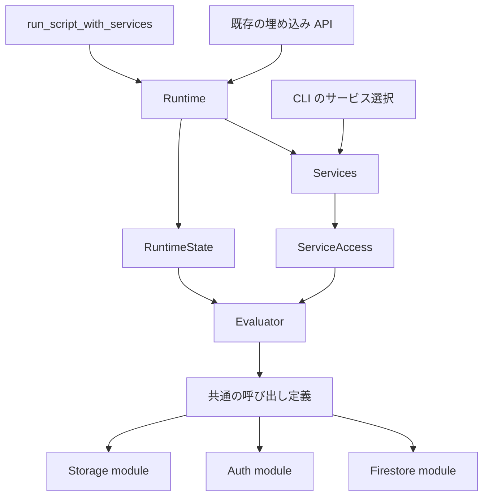

# Firebase Services と組み込み module の設計案

対象: [Issue #78](https://github.com/hirokazumiyaji/firelang/issues/78)

この文書は実装前の設計案である。
現行の正式仕様は [docs/spec.md](../spec.md) であり、この設計案によって現行の挙動を変更するものではない。
コード調査の基点は `b38bc96`。

Firestore、Auth、Storage を一つのスクリプトから使い、サービスごとにバックエンドを差し替えられる構成を設計する。
言語 API は `Firestore.*`、`Auth.*`、`Storage.*` の組み込み module に分ける。
初期の実装範囲は組み込み module とする。
ユーザー定義の `module` 構文、`include`、`extend`、定数の一般的な仕組みは後続の言語機能とする。

## 1. 現在の実装と Issue の残作業

Issue の記述から実装が進んでおり、Auth / Storage の trait とバックエンドを新設する作業は不要である。

| 対象 | 現在の実装 | 今回必要な変更 |
| --- | --- | --- |
| バックエンド | `Firestore`、`Auth`、`Storage` と各 in-memory / emulator 実装が存在する | 既存 trait と実装を再利用する |
| Runtime | `Runtime<F, S>` が Firestore、Storage、`Box<dyn Auth>` を別々に保持する | 所有権を `Services` にまとめ、実行器から generic parameter を除く |
| 埋め込み API | サービスの組み合わせ別の関数とコンストラクタが存在する | 新しい標準入口を `run_script_with_services` に統一する |
| 言語 API | Firestore 操作と `auth_*` / `storage_*` がグローバル関数である | 組み込み module から同じ実装を呼び出す |
| サービス未設定 | コンストラクタが未指定サービスを in-memory で補う | 新 API では未設定を明示できるようにする |
| timeout | Firestore は Runtime の設定、Auth は HTTP client の固定 15 秒、Storage は接続 5 秒と read/write 30 秒 | 設定値と保証範囲をサービスごとに明示する |
| project | CLI / バックエンドが個別に環境変数を読む | 新しい構成経路では project 設定を一度解決して渡す |

`src/runtime.rs` の組み込み関数にも `F` / `S` が付いている。
サービスのフィールドをまとめるだけでは、Issue の「サービス追加で各組み込み関数の generic parameter を増やさない」という条件を十分に解決できない。
そのため、公開 Runtime と内部の実行器を分ける。

## 2. 構成方式の比較

| 方式 | 利点 | 負担・制約 | 判断 |
| --- | --- | --- | --- |
| 既存の公開 Runtime の型を保ち、内部実行器で `dyn Trait` を借用する | `Runtime<F, S>` の型注釈と借用 Storage を維持できる。組み込み関数は generic 不要になる | 所有する構成と借用する実行器の二つが必要 | 採用する |
| Runtime と Services をすべて `Box<dyn Trait>` にする | 所有する型も非 generic にできる | `Runtime<InMemoryFirestore>` がコンパイルできなくなる。既存の借用 API に lifetime の再設計が必要 | 公開 API を破壊する版で再検討する |
| `Runtime<F, A, S, ...>` と generic parameter を追加する | バックエンドを具体型のまま保持できる | 組み込み関数やコンストラクタがサービス数に応じて増える | 採用しない |

既存公開 API のために残す generic parameter は現在の `F` / `S` だけとする。
Auth と今後追加するサービスは Services の boxed trait object とし、Runtime の型引数を増やさない。
これは Firebase 向けのサービス境界であり、複数 cloud provider を統一する抽象化には拡張しない。

## 3. 所有権と実行器

以下は型の構成案であり、実装コードではない。

```rust
pub struct Services<F: Firestore, S: Storage = InMemoryStorage> {
    firestore: F,
    storage: S,
    auth: Box<dyn Auth>,
    project: ProjectConfig,
}

pub struct Runtime<F: Firestore, S: Storage = InMemoryStorage> {
    services: Services<F, S>,
    state: RuntimeState,
}

struct ServiceAccess<'a> {
    firestore: &'a mut dyn Firestore,
    storage: &'a mut dyn Storage,
    auth: &'a mut dyn Auth,
    project: &'a ProjectConfig,
}

struct Evaluator<'a> {
    services: ServiceAccess<'a>,
    state: &'a mut RuntimeState,
}
```

`RuntimeState` が scopes、batch / transaction 状態、pending rollback、実行予算、usage、call depth、実行中フラグを保持する。
`Runtime::run` / `eval_program*` は Services と state を同時に借用し、その呼び出し中だけ Evaluator を作る。
Evaluator が AST を評価し、バックエンドは借用した trait object を通して呼ぶ。
実行をまたいで残す状態を Evaluator のローカルフィールドへ移さない。
特に rollback の再試行状態と Auth のセッションを実行終了時に消さない。

Auth のセッションの所有者は現在と同じ Auth バックエンドである。
Services や RuntimeState に別の current user / token を複製しない。
同じ Runtime の複数回の `run` では、そのバックエンドのセッションを維持する。
新しい Runtime の生成と `sign_out` がセッションの境界になる。

組み込み関数と ScopeGuard は Evaluator を受け取り、`F` / `S` を要求しない。
公開 Runtime のコンストラクタと実行入口には、Services の構築・借用・委譲だけを残す。
既存入口と新入口で別々の評価ロジックを持たない。



## 4. Services の公開 API と未設定サービス

### 4.1 構築 API

新しい標準 API は以下の形とする。
`with_*` はバックエンドを所有し、同じサービスを再指定した場合は新しいバックエンドに置き換える。

```rust
Services::in_memory() -> Services<InMemoryFirestore, InMemoryStorage>
Services::empty(project: ProjectConfig)
    -> Services<UnavailableFirestore, UnavailableStorage>

Services<F, S>::with_firestore<F2: Firestore>(self, firestore: F2)
    -> Services<F2, S>
Services<F, S>::with_storage<S2: Storage>(self, storage: S2)
    -> Services<F, S2>
Services<F, S>::with_auth<A: Auth + 'static>(self, auth: A) -> Self
Services<F, S>::with_project(self, project: ProjectConfig) -> Self

Runtime<F, S>::from_services(services: Services<F, S>) -> Self
Runtime<F, S>::from_services_with_limits(
    services: Services<F, S>, limits: RuntimeLimits
) -> Self

run_script_with_services<F: Firestore, S: Storage>(
    source: &str, services: Services<F, S>
) -> Result<Value, Box<dyn Error>>

run_script_with_services_and_limits<F: Firestore, S: Storage>(
    source: &str, services: Services<F, S>, limits: RuntimeLimits
) -> Result<Value, Box<dyn Error>>
```

`Services::in_memory()` は三サービスを in-memory にする。
`Services::empty(project)` は三サービスを未設定にする。
新 API には「サービスを省略すると emulator を探し、失敗すると in-memory に切り替える」という経路を設けない。
CLI の現行 `storage auto` の挙動は CLI 内で扱う。

```rust
let services = Services::in_memory()
    .with_auth(custom_auth)
    .with_storage(custom_storage);
let mut runtime = Runtime::from_services(services);
runtime.run(source)?;

let services = Services::empty(project)
    .with_auth(InMemoryAuth::default());
let result = run_script_with_services("Auth.current_user()", services)?;
```

既存の Storage の借用用途も維持する。
`Services::in_memory().with_storage(&mut storage)` が使え、`Storage` に `'static` を追加しない。
Auth の `'static` 制約は現行 API と同じとする。
trait 全体に新しい `Send` / `Sync` 制約を追加しない。

### 4.2 未設定サービスの表現

未設定を表す `UnavailableFirestore` / `UnavailableAuth` / `UnavailableStorage` を用意する。
これらはサービスを実装する型であり、呼び出された操作をエラーにする。
別バックエンドに処理を切り替える機能は持たない。
Auth を未設定にしても `Runtime::auth()` / `auth_mut()` の既存シグネチャを保てる。

三つのサービス trait に `is_available(&self) -> bool` を追加する。
既定実装は `true` を返し、Unavailable 型だけ `false` を返す。
既存の custom backend に新しい必須メソッドを要求しない。
Availability の別フラグを Services に重複保持しない。

言語のサービス操作では引数評価前に availability を検査する。
Auth 未設定の `Auth.current_user()` は `nil` ではなく capability error になる。
設定済み Auth で未ログインの場合は、現在と同じく `nil` になる。
この二つの状態を区別する。

`CapabilityError` は独立した公開エラー型とする。
`service: ServiceId` と `span: Option<Span>` を持ち、`Box<dyn Error>` から downcast できる。
`ServiceId` は `Firestore` / `Auth` / `Storage` の enum とする。
表示は `1:1: service unavailable: Auth` の形にする。
実行フェーズは Runtime エラーとして扱い、既存の `ErrorKind` enum と `FirelangError` の公開フィールドは変更しない。
位置の付与とエラーのラップ処理では CapabilityError の型を保持する。

Auth trait の直接利用は既存の `AuthError` が戻り値であるため、UnavailableAuth は `AuthError::Configuration` を返す。
言語 API では availability の事前検査によって共通の CapabilityError を返す。
既存の AuthError の enum variant を増やして外部の exhaustive match を壊さない。

Firestore の参照・クエリ・センチネルの構築は通信を行わず、未設定でも許可する。
`Firestore.get/set/update/delete/batch/transaction` とクエリの `get/count` では Firestore を必須とする。
Auth / Storage の各サービス操作では対応するサービスを必須とする。

## 5. 組み込み module の言語仕様

### 5.1 公開する操作

```ruby
session = Auth.sign_in("alice@example.com", "password")
user = session.user

Firestore.set("users/#{user.uid}", {email: user.email})
Storage.upload("avatars/#{user.uid}.bin", bytes([0, 255]),
               content_type: "application/octet-stream")

rows = Firestore.col("users").where("email", "==", user.email).get()
puts rows
Auth.sign_out()
```

この例のログインは Auth のセッションを作る。
Firestore / Storage のリクエスト資格情報に token を自動転送する意味は持たない。

| module | 公開メソッド | 対応する現行 API |
| --- | --- | --- |
| Firestore | `doc`, `col`, `col_group` | 同名のグローバル関数 |
| Firestore | `get`, `set`, `update`, `delete` | 同名のグローバル関数 |
| Firestore | `batch`, `transaction` | 同名のブロック付き関数 |
| Firestore | `server_timestamp`, `array_union`, `array_remove`, `delete_field`, `increment` | 同名のセンチネル生成関数 |
| Auth | `sign_up`, `sign_in`, `current_user`, `sign_out` | `auth_` prefix のグローバル関数 |
| Storage | `upload`, `download`, `metadata`, `delete` | `storage_` prefix のグローバル関数 |

`puts`、`array`、`len`、`bytes`、`timestamp`、`now` は言語全体の値操作なのでグローバルに置く。
`Firestore.timestamp` や `Storage.bytes` は追加しない。
Firestore のクエリチェーンと AuthSession のフィールドアクセスは現在の形を保つ。
`Firestore.set(..., merge: true)` と `Storage.upload(..., content_type: ...)` は既存と同じ keyword argument を受け付ける。
`Firestore.batch { ... }` / `Firestore.transaction { ... }` は既存と同じ block / return の意味を持つ。

mruby は module の定義と module function の登録をそれぞれ提供している。
今回採用するのは module に所属する操作を呼び出す形であり、mruby の mixin や private instance method まで再現しない。
根拠: [mruby 公式 C API Reference](https://github.com/mruby/mruby/blob/master/doc/guides/capi.md#defining-methods)。

### 5.2 構文と module 値

`Firestore.set(...)` は現行 AST の `Expr::Call { receiver: Some(...), ... }` で表現できる。
大文字始まりの名前も現行 lexer の identifier として読める。
lexer / parser / AST の構文を増やさず、Runtime に組み込み module の名前解決を追加する。

`Value::Module(BuiltinModule)` を追加する。
`BuiltinModule` は `Firestore` / `Auth` / `Storage` の固定 enum である。
module 値にバックエンド、token、project config を入れず、呼び出し時に実行中 Runtime の Services を参照する。
未設定サービスでも module の名前は存在するため、未設定を undefined variable として報告しない。

以下の規則に固定する。

- 通常の変数・関数の名前解決を先に行い、見つからなければ三つの組み込み module 名を解決する。
- 既存の `Auth = ...` などのローカル変数を新しい予約語として禁止しない。そのスコープではローカルの値が優先される。
- `a = Auth; a.current_user()` のように別名で参照できる。
- module 値は immutable であり、メソッドの追加・変更・再定義の API は提供しない。
- `inspect` / `to_s` は `Firestore` / `Auth` / `Storage` の名前を返す。同じ module ID の値は等しい。
- module 値は truthy であり、深さの検証では leaf として扱う。
- Firestore の保存値、filter operand、transform operand として module 値を受け付けない。Map / Array 内にある場合も通信前に拒否する。
- Storage の内容には既存どおり Bytes のみを受け付ける。

この名前解決は今回の組み込み namespace の仕様であり、Ruby の一般的な定数探索を導入するものではない。

### 5.3 共通の呼び出し定義

メソッド名を別のグローバル関数名に書き換えて再評価する方式は採用しない。
module 呼び出しと既存グローバル関数を、同じ BuiltinSpec の handler に解決する。

BuiltinSpec には以下を保持する。

- 所属 module、公開メソッド名、既存のグローバル名。
- 引数個数、keyword、位置引数と keyword の重複、block の CallContract。
- 必要なサービス。参照構築や値操作の場合はなし。
- generic parameter を持たない handler。

現在の `BUILTIN_NAMES`、handler table、`builtin_contract` の重複をこの定義にまとめる。
所属サービスの操作定義は各サービスの Rust ファイルに置き、共通側は名前解決と呼び出しを担う。
任意のプラグインを登録する汎用 registry は作らない。

呼び出し順序は次のとおりとする。

1. 重複 keyword と、receiver の評価なしに確定できる不正を検出する。
2. receiver があれば一度だけ評価する。ここで Return が発生した場合は伝播する。
3. receiver の種類に応じて BuiltinSpec / 既存メソッド / ユーザー関数を解決する。
4. 引数個数、keyword、block、サービスの availability と実行コンテキストを検査する。
5. 引数をソース順に評価する。位置引数と keyword を別々の順序で評価しない。
6. 評価済みの値を handler に渡す。

現行実装は receiver 付き呼び出しの keyword と `each/map` 以外の block を早い段階で一律拒否する。
この処理を module の CallContract に対応させる必要がある。
構文が通るだけでは `Firestore.set(..., merge: true)` と `Firestore.batch { ... }` は動かない。
通常の Array / Query / Map メソッドについては、keyword / block の可否と、不正な呼び出しで引数を評価しない保証を保つ。
receiver の種類によって keyword / block の可否が異なるため、重複 keyword などを除き、receiver を評価してからその可否を検査する。
これにより、不正な keyword / block を持つ通常メソッドでも receiver 自身が先に評価される場合がある。
現在はそれらを receiver の評価前に拒否しているので、この評価順とエラーの優先順位は明示的な言語仕様の変更として扱う。
例として `receiver().len(nope: true)` は、receiver に書かれた副作用が起きた後で keyword error になるが、`nope` の値の式は実行しない。
receiver 自身の副作用を取り消せるとは約束しない。
receiver が Module を返す任意の式でも、同じ規則で keyword / block を扱えるようにし、構文の形ごとの特別扱いを増やさない。

不正な `Storage.upload` や未設定の Auth 呼び出しが、引数に書かれた Firestore 書き込みを実行しないことを検査する。
未知の module メソッドは `unknown module method: Auth.foo` の形で報告する。

### 5.4 互換性と batch / transaction

既存グローバル関数は、同じ handler / CallContract に解決する別の公開名として維持する。
引数の変換、失敗時の再試行、旧 Runtime に戻す分岐は設けない。
新しいサンプルと説明では module API を標準とし、既存グローバル関数の削除や deprecation は今回行わない。

Firestore の batch / transaction は Firestore の操作だけを atomic にする。
Storage は現在と同じく内部から呼び出せない。
Auth は現行実装では内部から呼び出せるため、今回はその可否を変更せず、Auth の変更が rollback の対象に含まれないことを仕様に明記する。
Auth 操作の禁止やサービスをまたぐ transaction は別の挙動変更として扱う。
module API と既存 API の間でこの可否を変えない。

## 6. project 設定、資格情報、identity

`ProjectConfig` は `project_id: Option<String>` と `storage_bucket: Option<String>` を持つ、秘密を含まない設定値とする。
環境変数の読み取りを設定型のデフォルト生成に含めない。
既存コンストラクタは project を未指定の config とし、既に生成されたバックエンドの project を書き換えない。
これにより、既存の `Runtime::new(FirestoreEmulator::new(...))` が違う project に接続し直す問題を避ける。
新 API で明示する config は、バックエンドを構築する際にも同じ値を渡す。
`with_project` に既存バックエンドを再構成する副作用は持たせない。
custom backend の内部 project はホストの責任とし、汎用 trait に project 検証を強制しない。

Auth の明示構築には `AuthEmulatorOptions { api_key: String, operation_timeout: Option<Duration> }` を追加する。
既定値は現在の emulator 用 API key `fake-api-key` と 5,000 ms とする。
`AuthEmulator::new_with_options(host, project_id, options) -> Result<Self, AuthError>` は環境変数を読まない。
既存の `new` / `from_env` は環境から options を解決してこの constructor に委譲し、シグネチャを保つ。
CLI は明示構築を使い、構築後の再読み取りをなくす。
Storage も既存の明示 constructor と bucket / token 指定を使い、CLI から `from_env` を呼ばない。

CLI では `FIREBASE_PROJECT_ID` / `GCLOUD_PROJECT` / `FIRESTORE_PROJECT_ID` を一度だけ読む。
複数が設定され、値が異なる場合は configuration error とする。
同じ値の重複は許可し、どれもなければ現行の `firelang-test` を使う。
これは現行のサービス別の優先順位を整理する変更なので、CLI の仕様変更として明記する。
Storage bucket は明示値を優先し、未設定なら現行 emulator 契約の `{project_id}.appspot.com` を使う。
この既定値を本番 bucket の命名規則として説明しない。

Firebase は emulator 間の連携のため同じ project ID を使うことを推奨している。
ここから、CLI の三サービスに同じ解決済み project を渡す設計を採用する。
根拠: [Firebase Emulator Suite の設定](https://firebase.google.com/docs/emulator-suite/install_and_configure)。

credentials / token はサービスのインスタンスが所有する。
ProjectConfig と module 値に格納せず、global mutable state に保存しない。
AuthSession / AuthToken の表示時の redaction と、保存できない値の検証を維持する。
パスワードや token を含むリクエスト・レスポンス本文をエラーメッセージに加えない。

今回は Auth の token を Firestore / Storage へ自動転送しない。
既存の Firestore admin mode と Storage の明示 token を維持する。
Auth にログインできることと、その identity で security rules が評価されることは、異なる機能として扱う。
後続タスクでは明示的な user identity mode、リクエスト直前の token の取得、期限切れ、sign-out、project の一致、owner token の扱いを設計する。
emulator の ID token は署名されておらず、本番 token として扱えない。
根拠: [Authentication Emulator との接続](https://firebase.google.com/docs/emulator-suite/connect_auth)。

in-memory backend は language contract の fake として使う。
security rules の評価器は実装せず、認可の許可・拒否は emulator integration test で検査する。

## 7. 同期実行と timeout の契約

Runtime と三サービスの trait は同期のままとする。
今回 async Runtime や自動的な background worker を追加しない。

### 7.1 設定とエラー

`RuntimeLimits.backend_timeout` の現行既定値 5,000 ms を三サービスへ伝える。
Firestore の既存 hook に合わせ、Auth / Storage に既定実装付きの `set_timeout` / `supports_backend_timeout` を追加する。
既定 hook は設定を保持しない no-op、supports は `false` とし、既存 custom backend の実装を維持する。
`Box<T>` / `&mut T` の既存 forwarding impl は新 hook も転送する。

`Runtime::backend_timeout_supported()` は現在と同じく Firestore の情報を返す。
新しく `service_backend_timeout_supported(service: ServiceId) -> bool` を用意し、Auth / Storage も個別に確認できるようにする。
サービス追加時に引数や戻り値の組み合わせを増やさない。

組み込みネットワークバックエンドは、一つの操作に絶対 deadline を設定する。
read を繰り返すたびに timeout を最初から数え直す方式では、少量ずつ応答するサーバーを制限できない。
Auth は send と response body の読み取りを一つの timeout で囲む。
Storage は connect / write / read の各段階で残り時間を設定し、アドレスの再試行も同じ deadline を使う。
Auth の固定 15 秒と Storage の固定 30 秒は、この設定値に置き換える。

同期の custom backend と OS の同期 DNS 解決は、Runtime から強制中断できない。
Storage の現在の TCP transport が同期 DNS 解決を含む間は、完全な操作 timeout の support を `false` と報告する。
socket I/O に deadline を適用できることと、DNS まで含む全操作を制限できることを混同しない。
完全な保証が必要な Storage transport の置き換えは、保証を `true` に変更する時点で実装・検査する。
この設計で三サービスに timeout の設定を統一しても、すべての独自実装を強制中断できるとは約束しない。

`max_wall_clock` は評価中のチェック地点で検査する現行の実行予算とする。
backend timeout と別の設定として扱い、今回「残り wall clock に合わせて外部操作を強制停止する」意味には拡張しない。
操作が終わった後で wall clock を超えた場合、成功済みの外部書き込みを取り消せるとは説明しない。

ネットワーク timeout は既存と同じ Backend error とし、Auth は既存の `AuthErrorKind::Network` を保持する。
token、password、HTTP body を表示しない。
connection setup の timeout は Runtime の生成前にクライアントへ渡し、実行中の予算とは分けて仕様化する。
`Runtime::set_limits` は次の操作から新しい設定を適用する。
transaction の rollback は元のエラーを維持し、失敗時の pending rollback 状態を維持する。

### 7.2 Tokio 上での利用

Firestore / Auth の emulator client は内部の Tokio Runtime で `block_on` する。
Tokio の task 内で同期ネットワーク API をそのまま呼ぶ利用方法はサポートしない。
組み込み client は nested runtime の状態を検査して Backend / Auth Network error を返し、Tokio の panic を利用者に渡さない。
in-memory の実行まで一律に禁止しない。

async の呼び出し元は blocking task または専用の同期スレッド内でクライアントと Runtime を構築して実行する。
既存の `Box<dyn Auth>` が Send を要求しないため、Runtime を構築してから `spawn_blocking` に移動できるとは約束しない。
async 呼び出しを支えるためだけに既存 trait へ Send を追加しない。

## 8. ファイルごとの責務

| ファイル | 責務 |
| --- | --- |
| `src/services.rs`（新規） | Services、ProjectConfig、ServiceId、ServiceAccess、未設定サービスの構成 |
| `src/runtime.rs` | 公開 Runtime、既存コンストラクタ、実行入口の委譲 |
| `src/runtime/state.rs`（新規） | 評価をまたいで保持する状態 |
| `src/runtime/evaluator.rs`（新規） | AST 評価、スコープ、制御フロー、call contract、budget 検査 |
| `src/runtime/builtins/mod.rs`（新規） | BuiltinSpec、module / global の解決、共通の呼び出し |
| `src/runtime/builtins/core.rs`（新規） | puts / array / bytes / timestamp などの値操作 |
| `src/runtime/builtins/firestore.rs`（新規） | Firestore handler、query 呼び出し、batch / transaction |
| `src/runtime/builtins/auth.rs`（新規） | Auth handler と session の投影 |
| `src/runtime/builtins/storage.rs`（新規） | Storage handler と Bytes / metadata の変換 |
| `src/value.rs` | BuiltinModule / Value::Module と表示・比較 |
| `src/error.rs` | CapabilityError と位置の保持 |
| `src/auth/*`、`src/storage/*` | availability / timeout hook と既存実装 |
| `src/lib.rs` | Services API の export と既存関数の委譲 |
| `src/main.rs` | 設定の一回の解決、サービス選択、Services の構築 |

Unavailable 型の trait 実装は各サービスの `unavailable.rs` に置き、Services がそれらを組み合わせる。
backend の CRUD や codec を今回の Runtime 再編のために移動しない。
Cargo feature の分割も今回行わない。
StorageEmulator が feature なしでも公開されている現行実装と、正式仕様の feature の説明の食い違いは、現行挙動に合わせてドキュメントを訂正する。
サービス別 feature の導入は別タスクとする。

## 9. 実装単位と依存関係

作業単位は独立してレビューできる変更の大きさにする。
各単位で実際の挙動を変える場合は `docs/spec.md` を同時に更新する。
以下の検査項目とコマンドは将来の実装時に実行するものであり、この設計作業ではテストを実行していない。

### Task 1: Services の導入と既存入口の集約

対象: `src/services.rs`、`src/runtime.rs`、`src/lib.rs`、`tests/services.rs`（新規）。

- Services と ProjectConfig を導入し、Runtime の三つのバックエンドフィールドを Services にまとめる。
- `in_memory` / `with_firestore` / `with_auth` / `with_storage` / `with_project` を実装する。
- `from_services*` / `run_script_with_services*` を追加する。
- 既存コンストラクタと `run_script_with_*` は Services 構築に委譲する。シグネチャと in-memory 補完の挙動を保つ。
- 三サービスを recording fake に別々に差し替え、同じスクリプトの呼び出しが指定した各バックエンドへ届くことを検査する。
- `Runtime<InMemoryFirestore>` の型注釈と借用 Storage の呼び出しを compile できることを検査する。

完了条件: 言語 API を変えず、新入口で三サービスを組み合わせられる。
検査: `cargo test --locked --test services --test auth --test storage --test in_memory`。

### Task 2: 内部実行器から generic parameter を除去

依存: Task 1。
対象: `src/runtime.rs`、`src/runtime/state.rs`、`src/runtime/evaluator.rs`、`src/runtime/builtins/*`、既存 Runtime の単体テスト。

- RuntimeState と借用 ServiceAccess / Evaluator を導入する。
- 評価メソッド、ScopeGuard、組み込み関数を移し、generic parameter を除去する。
- query の shaped / bounded な取得、codec の depth 設定、transaction lifecycle の既存経路をそのまま保持する。
- `run` を繰り返したときの scopes / Auth session / usage reset を検査する。
- `return`、引数 binding error、panic unwind からの復帰、失敗した rollback の再試行を既存テストで検査する。

完了条件: 組み込み関数と評価メソッドの型に `F` / `S` がなく、既存の budget / transaction 契約を維持する。
検査: `cargo test --locked`。

### Task 3: 明示的な未設定サービスと capability error

依存: Task 2。
対象: `src/services.rs`、各サービスの trait / `unavailable.rs`、`src/error.rs`、評価器、`tests/services.rs`。

- `is_available`、Unavailable 型、`Services::empty(project)`、CapabilityError を導入する。既存の `Box<T>` / `&mut T` forwarding impl に availability の転送も追加する。
- 共通呼び出しに必要なサービスの情報を持たせ、引数評価前に検査する。
- Auth-only / Storage-only / Firestore-only の Services を検査する。
- 未設定 Auth の current_user は CapabilityError、設定済み未ログインは Nil となることを検査する。
- 未設定サービスの呼び出しに副作用のある引数を渡し、副作用が起きないことを検査する。
- module 導入前のグローバル関数と query get/count にも同じ検査を適用する。
- CapabilityError の downcast と source span を検査する。

完了条件: 未設定が in-memory で暗黙に補われず、未ログイン・未存在・ネットワーク失敗と区別できる。
検査: `cargo test --locked --test services --test in_memory`。

### Task 4: 組み込み module 値と共通の呼び出し定義

依存: Task 3。
対象: `src/value.rs`、評価器、`src/runtime/builtins/*`、Firestore の共通値検証、`tests/modules.rs`（新規）。

- BuiltinModule / Value::Module を導入し、通常の変数探索の後に三つの名前を解決する。
- BuiltinSpec に handler / CallContract / 所属 / 公開名 / 必要サービスをまとめる。
- module と既存グローバル関数から同じ handler に到達させる。
- receiver 付き呼び出しの keyword / block 検査を module に対応させる。
- 三 module の全メソッドと既存 API の戻り値・副作用・エラー分類を比較する。
- merge / content_type の位置引数と keyword の重複、未知 keyword、不正 block、未知メソッドを検査する。
- receiver が一度だけ評価され、引数がソース順に評価されることを検査する。
- 不正な通常メソッドの keyword / block は、receiver の評価後・引数の評価前に拒否される新しい順序を正式仕様とテストに反映する。
- alias、関数内の参照、通常変数による shadow、inspect、nested Module の保存拒否を検査する。
- module 経由でも transaction の return / rollback と Storage の内部呼び出し拒否が同じであることを検査する。

完了条件: 新しい構文を追加せず、三 module と既存グローバル関数が同じ契約で動く。
検査: `cargo test --locked --test modules --test services --test auth --test storage --test in_memory`。

### Task 5: CLI の Services 構築と共通 project 設定

依存: Task 1。統合の最終確認は Task 4 の後に行う。
対象: `src/main.rs`、バックエンドの明示設定による構築経路、`tests/cli.rs`、`tests/firebase_config.rs`。

- CLI で project 設定を一度解決し、選択した三バックエンドへ渡す。
- AuthEmulator の `new_with_options` / AuthEmulatorOptions を追加し、API key を constructor 内で環境から読み直さず、解決済み options として渡す。既存 constructor はその経路に委譲する。
- 現行のサービス選択を維持し、選択結果から一つの Services を作る。
- Firestore / Storage の組み合わせごとにスクリプトを実行する match の重複を除去する。
- 必要な `Firestore for Box<T>` forwarding impl を追加し、query page/count/bounded、transaction、timeout、depth の hook も転送する。
- project 環境変数の単独指定、同値の重複、衝突、未設定と bucket override を検査する。
- emulator を明示指定した場合の host 不足と feature 不足、Storage auto の現在の挙動を検査する。

完了条件: CLI が新入口を一回だけ呼び、三サービスの project 設定が一致する。
検査: `cargo test --locked --test cli --test firebase_config`。

### Task 6: timeout の設定伝播と同期 client の制約

依存: Task 2。
対象: 各サービスの trait、AuthEmulator、StorageEmulator / transport、Firestore emulator client、`tests/budgets.rs`、バックエンドの単体テスト。

- Auth / Storage の timeout hook とサービス別の support 確認 API を追加する。
- Runtime の生成と `set_limits` の両方で三サービスへ設定を伝える。
- Auth の HTTP 操作全体と Storage の socket 操作の deadline を実装する。
- 設定を無効にした場合と、Runtime の生成前の接続予算を区別する。
- fake backend で三サービスへの設定値と `Box<T>` / `&mut T` の転送を検査する。
- ローカルの遅延サーバーで response body の停滞と少量ずつの応答を検査する。外部ネットワークに依存しない。
- Storage の同期 DNS 制約がある間は support=false、Auth / Firestore の保証できる経路は support=true と検査する。
- Tokio task からの Firestore / Auth 操作が panic せず説明付きのエラーになることと、in-memory は動くことを検査する。
- timeout 後も token が表示されず、transaction の cleanup と Runtime の再利用が維持されることを検査する。

完了条件: 三サービスへ同じ設定が届き、強制できない範囲を API と文書で確認できる。
検査: `cargo test --locked --test budgets` と `cargo test --locked --features emulator`。

### Task 7: emulator と in-memory の共通 language contract

依存: Task 4、5、6。
対象: `tests/common/*`、`tests/modules.rs`、既存三サービスの emulator test、`tests/services.rs`。

- サービスごとの共通 script / assertion を用意し、in-memory と emulator に適用する。
- token の文字列や emulator の uid の具体値は一致条件に含めず、戻り値の shape と表示・操作契約を比較する。
- 三サービスを使う一つの script を両構成で実行する。
- emulator と in-memory を混ぜた構成でも、指定したバックエンドへ到達することを検査する。
- emulator test は対象サービスの起動設定がある場合に実行し、実行したサービスを skip で成功扱いにしない。
- 既存の deny rules の検査を維持する。Auth token と rules の統合をこの共通 contract の成立条件に加えない。

完了条件: 三サービスの language contract が各実装で一致し、emulator のない環境で新 API / module API を検査できる。
検査: `cargo test --locked` と、ローカルの三 emulator を起動した `cargo test --locked --features emulator`。

### Task 8: 正式仕様とサンプルの統合

依存: Task 7。各 Task の挙動変更はそれぞれの時点で正式仕様に反映する。
対象: `docs/spec.md`、`README.md`、`docs/firebase-security.md`、`examples/scripts/*`、`tests/example_scripts.rs`。

- module API、Services API、未設定サービス、timeout support、同期実行の制約を正式仕様にまとめる。
- 三サービスを組み合わせる module API のサンプルを追加する。
- 既存 API の互換性を確認するサンプルを残す。
- Auth が rules の identity に自動接続されないことと、Auth が Firestore transaction の rollback 対象でないことを明記する。
- security 文書に残っている「Auth emulator を起動しない」「Storage が Runtime API に含まれない」という古い記述を訂正する。
- StorageEmulator の現行 feature の公開条件を実装に合わせて訂正する。
- ライブラリ利用例をコンパイルでき、掲載 script が example test で実行できることを検査する。

完了条件: 言語仕様、Rust API、CLI、サンプルが実際の契約と一致する。
検査: `cargo test --locked --doc` と `cargo test --locked --test example_scripts`。

推奨実装順序は Task 1 → 2 → 3 → 4 → 5 → 6 → 7 → 8 とする。
Task 5 と 6 はそれぞれの依存 Task が終われば先に着手できるが、全体の契約の統合は Task 7 で行う。

## 10. 受け入れ条件の対応

| Issue / 設計の条件 | 実装単位 | 確認する事実 |
| --- | --- | --- |
| Firestore のみを生成する既存コードが動く | Task 1、2 | 既存シグネチャ、型注釈、実行結果が維持される |
| Auth と Storage を別々に差し替えられる | Task 1、7 | recording fake と混在構成が選択した backend に到達する |
| emulator なしで同じ script を実行できる | Task 4、7 | Services::in_memory と module API が通常のテストで動く |
| サービス追加で組み込み関数の型引数が増えない | Task 2 | Evaluator / handler が非 generic である |
| 未設定サービスを明示できる | Task 3、4 | CapabilityError の service / span と副作用の抑制が確認できる |
| サービス別の module API を提供する | Task 4 | 全公開メソッドが既存 API と共通の handler に解決される |
| token を通常の表示や保存に漏らさない | Task 4、6、7 | AuthSession、Module、timeout error の表示と保存拒否を確認する |
| timeout と async の制約が明確である | Task 6、8 | 設定伝播、support、nested Tokio の失敗方法が一致する |

## 11. 後続タスク

以下は Services / 組み込み module の導入後に独立して設計する。

- Auth identity と Firestore / Storage security rules の接続。
- ユーザー定義 module と名前空間内の関数・定数の探索。
- Firestore / Auth / Storage ごとの Cargo feature 分割。
- 同期 DNS 解決も含めて操作全体の deadline を強制できる Storage transport。
- 本番 Firebase、token refresh、OAuth / anonymous sign-in。
- async Runtime。必要な Send / Sync、所有権、キャンセルの意味を別途定義する。

サービスを一つ追加するときは、trait / backend、Services の所有フィールドと ServiceAccess の借用フィールド、必要なら module の操作定義を追加する。
公開 Runtime の型引数、既存の組み込み handler のシグネチャ、組み合わせ別の実行入口は増やさない。
